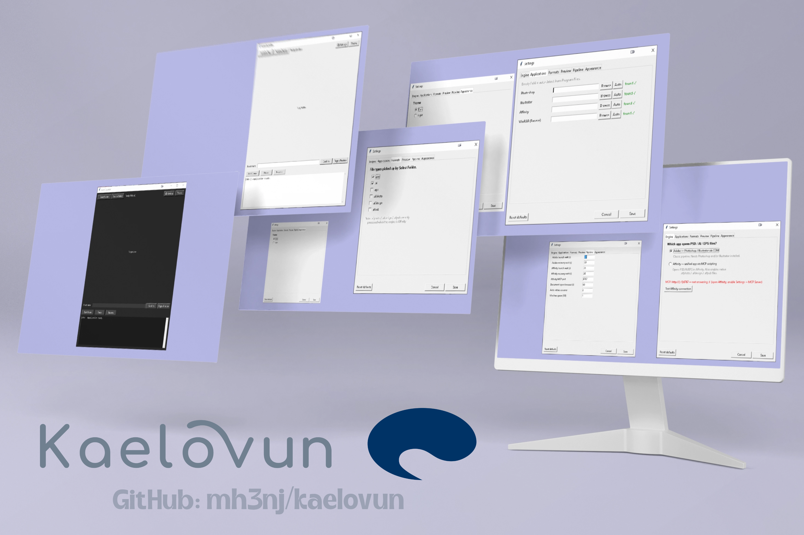

<p align="center">
  <picture>
    <source media="(prefers-color-scheme: dark)" srcset="assets/banner.webp">
    
  </picture>
</p>

<p align="center">
  <strong>Kaelovun</strong>
</p>

<p align="center">
  <strong>Universal Creative Asset Processing & Preservation Engine</strong>
</p>

<p align="center">
  <a href="#"></a>
  <a href="#"></a>
  <a href="#"></a>
  <a href="#"></a>
  <a href="#"></a>
  <a href="#"></a>
  <a href="docs/affinity-setup.md"></a>
  <a href="https://github.com/mh3nj/kaelovun/releases"></a>
  <a href="https://github.com/mh3nj/evoury"></a>
</p>

---

> **Note:** Kaelovun was previously named **Asset Organizer**. The application was rebranded in v1.3.1. In v1.4.0, Kaelovun evolved into a standalone universal creative-asset processing engine with package-based architecture, archive extraction, and headless CLI operation. In v1.5.0, safe-copy model for all inputs and manifest-based archive verification were added. In v1.6.0, archives can be written as **RAR, 7z or ZIP** (or whichever of 7z/RAR is smaller), existing archives can be **converted between formats**, and archive handling got real safety limits and a much stricter verification step. In v1.7.0, Kaelovun gets a **Windows installer**, ships the **34 mh3nj color themes**, and the Convert window's target, compression and original-file rows became read-only announcers backed by Settings.

Kaelovun processes **any creative asset input** — individual files (PSD, AI, INDD, Affinity formats), directories, or archives (ZIP, RAR, 7z, tar, etc.) — automatically discovering, classifying, and processing them into verified archives (RAR, 7z or ZIP) with AVIF previews.

**The philosophy:** *"Understand what you can. Preserve what you cannot."*

- **Automatic classification** — No manual mode selection. Kaelovun detects file types and selects the right processor.
- **Package preservation** — Directory structures are preserved. Licenses, docs, fonts, and unknown files are never deleted.
- **Safe archive handling** — Archives are *inspected before they are unpacked*: path traversal, absolute paths, links, entry count, unpacked size and unpack ratio are all checked first, and limits are enforced on the bytes actually written.
- **Verified output** — Every archive is built under a temporary name, integrity-tested and compared to a manifest (names + sizes, optionally CRC32), and only then renamed into place. It never overwrites an existing file.
- **Headless-first** — Full CLI for automation, plus GUI for interactive use.
- **Evoury integration** — Works standalone or as Evoury's processing engine.

---

## Pipeline

Each **asset package** (file, directory, or archive) goes through these stages:

| # | Stage | Description |
|---|-------|-------------|
| 1 | **Discover** | Recursively scan input, classify every file |
| 2 | **Extract / Copy** | Archives extracted to isolated workspace; directories/files copied to safe workspace (configurable depth limit for archives) |
| 3 | **Classify** | Transformable / Preservable / Container / License-Doc |
| 4 | **Preview** | Generate AVIF previews + thumbnails for transformable assets |
| 5 | **Process** | Hide layers, save transformable files (Photoshop/Illustrator/Affinity) |
| 6 | **Reconstruct** | Preserve original directory structure in workspace |
| 7 | **Archive** | Build RAR5, 7z or ZIP under a temporary name (format and level from Settings) |
| 8 | **Verify & publish** | Integrity test + manifest comparison (names, sizes, optional CRC32), then an atomic rename to a unique final name |
| 9 | **Cleanup** | Only after successful verification — remove workspace, keep originals |

---

## Features

- **Universal Input** — Single file, directory, or archive. Kaelovun figures it out.
- **Package Model** — Logical asset packages preserve directory hierarchy (`SOURCE/`, `EXPORT/`, `LICENSE/`, etc.)
- **Processor Architecture** — Photoshop, Illustrator, InDesign, Affinity, Image, PDF, Archive, Preservation processors
- **Conservative Preservation** — Unknown files, licenses, docs, fonts are always preserved
- **Safe Workspace (Safe-Copy Model)** — All inputs (files, directories, archives) copied to isolated workspace before processing; originals never modified
- **Manifest Verification** — Archive contents verified against an expected manifest of names and sizes (CRC32 in *paranoid* mode), not just an integrity test
- **RAR, 7z or ZIP output** — Pick the format in Settings > Archive, or choose *Smallest* to build all three and keep the smallest. 7z needs [7-Zip](https://www.7-zip.org/); RAR needs WinRAR; ZIP needs nothing
- **Archive converter** — Convert existing RAR / 7z / ZIP / TAR archives between formats, individually or whole folders, verified and non-destructive (see [Converting archives](#converting-archives))
- **Safer queue and naming** — Pause/stop can no longer deadlock, retries are counted correctly, GUI naming shows the preview with the default pre-filled, and your name history persists (Tab completes)
- **Configurable Preview Formats** — `PREVIEW_FORMAT` / `THUMB_FORMAT` settings (AVIF default, PNG/WebP/etc. supported)
- **Nested Archive Safety** — Configurable depth limit (default 2), preserves beyond boundary
- **Security** — Path traversal protection, links never extracted, archive bomb limits (size, ratio, entry count) enforced before and during extraction
- **CLI + GUI** — `kaelovun-cli` for automation, Tkinter GUI for interactive use
- **34 themes** — Pick any of the mh3nj color themes (17 families, dark and light) in Settings > Appearance, or cycle through them with the theme button. The header logo flips to match
- **Windows installer** — Per-user install with Start Menu shortcuts and a clean uninstall, no admin prompt. The portable zip still works the same way
- **Session Persistence** — Resume interrupted jobs, recover from crashes
- **Optional sidecar manifest** — `<archive>.kaelovun.json` next to each archive, a stable description for Evoury and other tools

---

## Screenshots

<p align="center">
  
</p>

---

## Requirements

### Runtime

| Component | Notes |
|-----------|-------|
| **Windows 10+** | COM interop is Windows-only |
| **Adobe Photoshop CS6+** or **Illustrator CS6+** | Default engine: opening, exporting, layer operations |
| **Adobe InDesign CS6+** | Optional: INDD support |
| **Affinity** (unified Canva-era app) | Optional engine: needs Settings → MCP Server enabled ([setup](docs/affinity-setup.md)) |
| **7-Zip** (`7z.exe`) | Needed for 7z output and for reading RAR/7z. Auto-detected (Program Files, PATH, or `vendor/7z/`) |
| **WinRAR** (`Rar.exe`) | Needed only to *create* RAR. 7-Zip can read RAR but cannot write it. ZIP output needs neither |

### Development (running from source)

| Dependency | Version |
|-----------|---------|
| Python | 3.11+ |
| `pywin32` | latest |
| `Pillow` | 10.0+ |
| `pillow-avif-plugin` | latest |
| `patool` | fallback extractor if 7-Zip is not installed (the import name is `patoolib`) |
| `Send2Trash` | Recycle Bin support in *Convert Archives* |
| `tkinterdnd2` | optional: drag and drop |
| `pytest` | only for running the tests (`requirements-dev.txt`) |

Install dependencies:

```bash
pip install -r requirements.txt
```

---

## Installation

Kaelovun runs on Windows only (it depends on Adobe COM interop). The setup scripts and manual steps below all assume a Windows environment.

### First run: configuration

Every setup path below needs one manual step the first time:

```bash
copy config.example.py config.py
```

`config.example.py` is a template; the app never imports it. It reads `config.py`, so without that copy the app won't start.

You usually don't need to edit anything afterwards: Adobe and WinRAR paths are **auto-detected** from `C:\Program Files`. Only touch `config.py` if you want to force a specific Adobe version or override defaults. `config.py` is gitignored; only ever push `config.example.py`.

### Windows installer (recommended)

Download the latest `Kaelovun-Setup-X.Y.Z.exe` from the [Releases page](https://github.com/mh3nj/kaelovun/releases) and run it. It installs per user into `%LOCALAPPDATA%\Programs\Kaelovun` (no admin prompt), adds Start Menu shortcuts (the Desktop shortcut is optional in the wizard) and registers Kaelovun in Settings > Apps. Uninstall from Settings > Apps or from the Start Menu shortcut; uninstalling removes the app folder, including its `data` folder (settings, session and logs). No Python or dependencies required; everything is bundled.

### Portable zip

Download the latest `Kaelovun-vX.Y.Z.zip` from the [Releases page](https://github.com/mh3nj/kaelovun/releases). Extract the **entire** archive and run `Kaelovun/Kaelovun.exe`. No Python or dependencies required; everything is bundled.

> **Extract everything, keep the folder together.** The exe needs its `_internal/` folder next to it (it holds `python3xx.dll` and the `scripts/` automation). If you move `Kaelovun.exe` out alone, or run it straight from inside the zip without extracting, Windows shows `Failed to load Python DLL ... _internal/python3xx.dll`. Fix: extract the full zip, then run `Kaelovun/Kaelovun.exe` from the extracted folder.

### Run from source with setup script

The repository includes two scripts that create a virtual environment, install dependencies, and launch the app:

**Windows:**
```batch
setup.bat
```

**Linux / macOS** (for development or testing; Adobe COM is Windows-only, so the pipeline itself will not work):
```bash
chmod +x setup.sh
./setup.sh
```

Each script checks for Python 3.11+, creates a `.venv` if one does not exist, installs `requirements.txt`, and runs `main.py`.

### Run from source manually

```bash
# Clone the repository
git clone https://github.com/mh3nj/kaelovun.git
cd kaelovun

# Create and activate a virtual environment
python -m venv .venv
.venv\Scripts\activate

# Install dependencies
pip install -r requirements.txt

# Create config.py from the template (one-time; paths auto-detect)
copy config.example.py config.py

# Launch the GUI application
python main.py

# Or run headless CLI
python cli.py --help
```

### Build a standalone executable

```bash
pip install pyinstaller
python -m PyInstaller Kaelovun.spec --noconfirm
```

The runnable app will be at `dist/Kaelovun/Kaelovun.exe` (with `dist/Kaelovun/_internal/` next to it). It includes all dependencies and the `scripts/` folder containing Adobe ExtendScript files. Or run `scripts/build_release.bat`; it builds from the spec, verifies `_internal/python3*.dll` exists, zips `dist/Kaelovun` to `Kaelovun-vX.Y.Z.zip` and builds the installer.

To build only the installer from an existing PyInstaller output, run:

```powershell
powershell -NoProfile -ExecutionPolicy Bypass -File scripts\build_installer.ps1
```

It reads the version from `cli.py` and produces `dist/Kaelovun-Setup-X.Y.Z.exe`. NSIS 3 is required (`makensis` on `PATH`); when it is not on `PATH`, the script falls back to Tauri's copy at `%LOCALAPPDATA%\tauri\NSIS\makensis.exe`. The script removes `dist/Kaelovun/_internal/data` first so local settings and logs never ship.

> **Always build from the `.spec` file.** Running `pyinstaller main.py` regenerates the spec with no data files and silently drops the `scripts/` folder, which makes every job fail with "Missing JSX".

> **Never run `build/Kaelovun/Kaelovun.exe`.** The `build/` folder only holds intermediate files; that exe always fails with `Failed to load Python DLL ... build/Kaelovun/_internal/python3xx.dll` because there is no `_internal/` there. Always run `dist/Kaelovun/Kaelovun.exe`.

---

## Usage

### GUI (Interactive)

1. Launch the application: `python main.py` or run `Kaelovun.exe`
2. Click **Select Folder** or **Select File** and choose a folder, file, or archive containing creative assets
3. Click **Start Queue**
4. For each package:
   - A preview appears (representative asset from the package)
   - Type a descriptive name and press Enter or click **Confirm**
   - Optionally, edit the document in Adobe and click **Regen Preview** before confirming
5. The app creates an archive (RAR, 7z or ZIP, per Settings > Archive) preserving the package structure. When the queue finishes a summary shows sizes before and after and any file that had a problem

Tips: the name box is pre-filled with the default name (just press Enter), **Tab** completes from names you've used before, and you can drag files, folders or archives onto the window if `tkinterdnd2` is installed.

### CLI (Headless / Automation)

```bash
# Process a single file
python cli.py project.psd

# Process a directory (recursive)
python cli.py /path/to/project_folder

# Process an archive (extracts, processes, re-archives)
python cli.py project.zip

# Resume failed jobs from last session
python cli.py --resume-failed

# Use Affinity engine
python cli.py --engine affinity /path/to/file.afphoto

# Limit archive extraction depth
python cli.py --max-depth 3 archive.rar

# Keep workspace for debugging
python cli.py --no-cleanup project.psd

# List supported formats and which archivers were found
python cli.py --list-formats

# Choose the output format for this run: rar | 7z | zip | smallest
python cli.py --format 7z /path/to/project_folder

# Show what would happen without changing anything
python cli.py --plan /path/to/folder

# Write archives somewhere else, use a roomy scratch drive, check CRC32 of every file
python cli.py --output D:\Library --workspace E:\scratch --verify paranoid project.psd
```

#### Converting archives (CLI)

```bash
# Convert one archive; the original stays untouched
python cli.py --convert-to 7z old.rar

# Convert every archive in a folder tree, send originals to the Recycle Bin after each verified conversion
python cli.py --convert-to 7z D:\Library --original recycle

# Preview only
python cli.py --convert-to 7z D:\Library --plan

# Other directions, with a password prompt for encrypted ones
python cli.py --convert-to rar a.7z b.zip --level best --ask-password

# Just integrity-test archives
python cli.py --verify-only D:\Library
```

### Controls (GUI)

| Control | Action |
|---------|--------|
| **Select Folder** | Scan a folder recursively for creative assets |
| **Select File** | Select a single file or archive for processing |
| **Resume Failed** | Re-queue incomplete jobs from the last session |
| **Convert Archives** | Open the archive converter (RAR / 7z / ZIP) |
| **Start Queue** | Begin sequential processing |
| **Pause / Resume** | Pause or resume between jobs |
| **Regen Preview** | Re-export the preview from the currently open document (during naming only) |
| **Confirm** | Accept the typed name and continue |
| **Theme** | Toggle dark and light themes |
| **Settings** | Engine, app paths, formats, preview, pipeline, **archive**, theme |

---

## Configuration

Prefer the in-app route: **Settings** writes to `data/settings.json` (gitignored, machine-local) and applies instantly; no restart, no rebuild. `copy config.example.py config.py` is still the one-time first step (the app only reads `config.py`), but you rarely need to open it: Adobe, Affinity, and WinRAR paths auto-detect from `C:\Program Files`.

`config.py` ships the defaults; `data/settings.json` holds your overrides. Delete `settings.json` (or Settings → Reset defaults) to go back to stock.

| Setting | Default | Description |
|---------|---------|-------------|
| `ENGINE` | `adobe` | `adobe` (Photoshop/Illustrator) or `affinity` (unified app via MCP) |
| `MAX_ARCHIVE_DEPTH` | `2` | Maximum nested archive extraction depth |
| `PREVIEW_WIDTH` | 2000 | Max preview width in pixels |
| `PREVIEW_HEIGHT` | 2000 | Max preview height in pixels |
| `PREVIEW_FORMAT` | `AVIF` | Preview output format (`AVIF`, `PNG`, `WEBP`, etc.) |
| `THUMB_WIDTH` | 400 | Thumbnail width in pixels |
| `THUMB_HEIGHT` | 400 | Thumbnail height in pixels |
| `THUMB_FORMAT` | `AVIF` | Thumbnail output format |
| `AVIF_QUALITY` | 90 | AVIF encode quality (0–100) |
| `AVIF_SPEED` | 6 | AVIF encoding speed (0=slowest/best, 10=fastest) |
| `THUMB_QUALITY` | 70 | Thumbnail quality |
| `MINIMUM_FREE_SPACE_GB` | 1 | Disk space safety threshold |
| `ADOBE_STARTUP_WAIT` | 20 | Seconds to wait for Adobe to launch |
| `ADOBE_RECOVERY_WAIT` | 20 | Seconds to wait after restarting Adobe |
| `DOCUMENT_TIMEOUT` | 60 | Seconds to wait for a document to finish opening |
| `MAX_RETRIES` | 2 | Number of automatic retries on recoverable errors |
| `AFFINITY_MCP_PORT` | 6767 | Local Affinity scripting server port |
| `AFFINITY_STARTUP_WAIT` | 25 | Seconds to wait for Affinity to launch |
| `AFFINITY_RECOVERY_WAIT` | 20 | Seconds to wait after restarting Affinity |
| `AFFINITY_RESTART_EVERY` | 10 | Recycle self-launched Affinity every N files (3.2.1 can't close tabs; 0 = never) |
| `NAMING_MODE` | `manual` | `manual` (prompt) or `automation` (auto-name) |
| `ARCHIVE_PROFILE.format` | `rar` | `rar`, `7z`, `zip`, or `smallest` (builds 7z, ZIP and RAR, keeps the smallest) |
| `ARCHIVE_PROFILE.level` | `best` | `fast`, `normal`, `best` |
| `ARCHIVE_PROFILE.solid` | `solid` | `solid`, `type` (solid per file type), `off` |
| `ARCHIVE_PROFILE.dict_mb` | 64 | Dictionary size. 7z at *best* needs roughly 10x this in RAM |
| `ARCHIVE_PROFILE.recovery_pct` | 0 | RAR recovery record, percent of archive size |
| `ARCHIVE_PROFILE.verify` | `standard` | `standard` (test + names + sizes) or `paranoid` (+ CRC32 of every file) |
| `ARCHIVE_PROFILE.write_sidecar` | `false` | Write `<archive>.kaelovun.json` next to each archive |
| `ARCHIVE_PROFILE.export_previews` | `true` | Save `<name>.avif` + `<name>.thumb.avif` next to each archive (Evoury reads these) |
| `ARCHIVE_PROFILE.max_extract_gb` / `max_ratio` / `max_files` | 200 / 300 / 250000 | Archive-bomb limits for archives Kaelovun opens |
| `SEVENZIP_PATH` | auto | Path to `7z.exe` |
| `WORKSPACE_DIR` | system temp | Scratch folder for copies and extractions. Pick a roomy, fast drive |
| `THEME` | `dark` | Startup theme (`dark` or `light`) |

---

## Supported Formats

| Format | Open | Export | Hide Layers | Save | Close |
|--------|------|--------|-------------|------|-------|
| `.psd`, `.psb` | ✓ | ✓ | ✓ | ✓ | ✓ |
| `.ai`, `.eps` | ✓ | ✓ | ✓ | ✓ | ✓ |
| `.indd`, `.indt` | ✓* | ✓* | ✓* | ✓* | ✓* |
| `.afphoto` | Affinity-only | ✓ (1024px) | ✓ (artwork) | native-only | (3.2.1) |
| `.afdesign` | Affinity-only | ✓ (1024px) | ✓ (artwork) | native-only | (3.2.1) |
| `.afpub` | Affinity-only | ✓ (1024px) | ✓ (artwork) | native-only | (3.2.1) |

*InDesign support depends on COM API availability.

**Preserved (not transformed):** PDF, fonts (OTF/TTF/WOFF), images (JPG/PNG/TIFF/WebP/AVIF/HEIC), SVG, unknown files, licenses, documentation.

---

## Archive Handling

Kaelovun safely processes archives:

1. **Inspect** the archive without unpacking it: unsafe paths, links, entry count, unpacked size and unpack ratio are judged first
2. **Extract** to an isolated workspace (ZIP/TAR by streaming code that enforces limits on bytes actually written; RAR/7z through 7-Zip)
3. **Classify** every file (transformable / preservable / container / license), nested archives up to `MAX_ARCHIVE_DEPTH`
4. **Process** transformable assets in the workspace
5. **Reconstruct** preserving the original directory structure
6. **Build** the archive under a temporary name (RAR5, 7z or ZIP)
7. **Verify** integrity + manifest comparison, then **publish** with an atomic rename to a name that doesn't exist yet. An existing `name.rar` becomes `name (2).rar`; nothing is ever appended to or overwritten

**Security protections:**
- Path traversal (`../`, absolute paths, drive letters) refused before anything is written
- Links are never extracted (and any that slip through are caught by a final sweep)
- Archive bombs: unpacked size, unpack ratio and entry count limits, enforced up front and on the bytes actually written
- Nested archives beyond the depth limit are preserved untouched
- Encrypted archives are preserved as-is unless you supply the password (conversion only)

**Supported archive formats:** ZIP, RAR, 7z, tar, tar.gz, tar.bz2, tar.xz (output: RAR, 7z, ZIP)

### Choosing 7z or RAR

7z (LZMA2) usually gives equal or smaller files than RAR5, but for creative assets the gap is often modest: PSD/AI layers and AVIF/JPEG previews are already compressed. Most of the gain comes from *solid* mode and a large dictionary. 7z is free and open; creating RAR needs WinRAR. *Smallest* builds both and keeps the winner, at twice the time.

### Converting archives

**Convert Archives** (GUI button or `--convert-to` on the CLI) changes the format of archives you already have. It never touches Adobe/Affinity and never changes the contents.

- The original is never modified. The result is built under a temporary name and only appears after it passes: extraction matches the source listing, the archiver's integrity test, and a content comparison (names + sizes, CRC32 in paranoid mode)
- Only one archive layer is unpacked; archives *inside* are copied as they are
- Results never overwrite anything (`name (2).7z`), and by default a result that isn't smaller is discarded
- *Remove original* means the Recycle Bin, and only after a verified conversion
- Multi-volume sets (`.part1.rar`, `.7z.001`) are handled from their first part; encrypted archives need their password (the converted archive is **not** encrypted)
- Timestamps of the files inside, and of the archive itself, are kept

---

## Evoury Integration

[Evoury](https://github.com/mh3nj/evoury) is a full-featured digital asset management (DAM) platform. It provides an asset grid, catalog browsing, and search across your organized library.

Kaelovun is the **independent** ingestion pipeline for Evoury. Together they form a complete workflow:

```
Source files (PSD/AI/INDD/Affinity/archives/directories)
        │
        ▼
Kaelovun ────→ Verified archives (RAR/7z/ZIP) + AVIF previews
(processing engine)        │
                           ▼
                      Evoury DAM
                  (catalog & management)
```

**Key separation:**
- **Evoury:** Asset discovery, library, metadata, organization, search, relationships, UI
- **Kaelovun:** Inspection, classification, processing, transformation, preview generation, package handling, archive extraction, RAR creation, verification, preservation

For every package Kaelovun writes `Name.<7z|rar|zip>`, `Name.avif` (preview) and `Name.thumb.avif` (thumbnail) side by side, plus an optional `Name.<ext>.kaelovun.json` manifest listing every file with its size and category. Evoury pairs them by folder and name, and ignores anything still being written (`*.kaelovun-part.*`). Turn the preview export off in Settings > Archive if you don't need it.

You can use Kaelovun without Evoury. It produces standard files that work with any file manager or search tool.

---

## Architecture

```
main.py                     GUI entry point
cli.py                      CLI entry point (headless)
├── config.py               Global configuration (local-only, gitignored)
├── config.example.py       Sanitized config template (push to GitHub)
├── logger.py               File, console, and UI logging
├── requirements_check.py   Environment verification
│
├── pipeline/               Processing pipeline
│   ├── processor.py        Main package-based pipeline orchestrator
│   ├── jobqueue.py         Sequential job queue (pause/stop via events)
│   ├── convert.py          Archive converter (RAR/7z/ZIP, verified)
│   ├── job.py              Job model and status enum
│   ├── scanner.py          Universal input scanner (file/dir/archive)
│   └── asset_package.py    AssetPackage model + classifier
│
├── adobe/                  Adobe COM integration
│   ├── photoshop.py        Photoshop COM controller
│   ├── illustrator.py      Illustrator COM controller
│   ├── indesign.py         InDesign COM controller (future)
│   ├── jsx_bridge.py       Loads and executes ExtendScript (.jsx)
│   └── recovery.py         Error classification and recovery
│
├── affinity/               Affinity MCP integration (unified Canva-era app)
│   ├── affinity.py         Affinity controller (open/render/hide/save/close)
│   ├── popups.py           Auto-dismiss updater + template/welcome popups
│   └── mcp_client.py       Stdlib-only MCP client (Streamable HTTP + SSE)
│
├── files/                  File operations
│   ├── app_settings.py     Settings store (data/settings.json overrides)
│   ├── archive.py          ArchiveManager: create/test/list RAR, 7z, ZIP
│   ├── archive_backends.py 7z / Rar.exe / ZIP backends, tool discovery, listing parsers
│   ├── archive_prefs.py    Archive preferences (defaults < config < settings.json)
│   ├── archive_extraction.py  Safe extraction: inspection, limits, link sweep
│   ├── manifest.py         Expected-vs-actual archive contents
│   ├── sidecar.py          Optional <archive>.kaelovun.json
│   ├── workspace.py        Scratch folder, free-space checks, stale cleanup
│   ├── cleanup.py          Post-verification cleanup
│   ├── filename.py         Name normalization and deduplication
│   ├── naming.py           Thread-safe name prompt
│   ├── preview.py          PNG to AVIF conversion
│   ├── session.py          Session persistence (data/session.json)
│   └── storage.py          Disk space monitoring
│
├── ui/                     User interface
│   ├── app.py              Tkinter GUI
│   ├── settings_dialog.py  Settings dialog
│   ├── archive_settings.py Settings > Archive tab
│   ├── convert_dialog.py   Convert Archives window
│   └── summary_dialog.py   End-of-queue summary
│
└── scripts/                Adobe ExtendScript + Affinity JS automation
    ├── photoshop_export.jsx
    ├── illustrator_export.jsx
    ├── indesign_export.jsx  (future)
    └── affinity_pipeline.js
```

---

## Data Safety

**Highest priority: NEVER LOSE USER DATA.**

- Original files are **never modified in place** — all inputs (files, directories, archives) copied to isolated workspace before any processing
- Archive verification **must pass** (integrity + manifest) before the archive gets its final name, and before any cleanup
- Archives are written under a temporary name and renamed into place: an existing archive is never appended to or overwritten, and a failed run leaves no half-written file
- Unknown/unrecognized files are **preserved**, not deleted
- Licenses, EULAs, documentation are **conservatively detected and preserved**
- Crash recovery: `Resume Failed` restores incomplete jobs from session
- Partial processing never destroys originals

---

## Security

Archives are treated as hostile input:

- Path traversal blocked (`../`, absolute paths)
- Symlink/hardlink escapes prevented
- Archive bomb limits (unpacked size, ratio, entry count) checked before extraction and on bytes written
- Recursive extraction depth limited (configurable)
- No arbitrary file execution
- Extracted content never escapes controlled workspace

---

## Testing

Run tests:

```bash
# Unit tests (no Adobe required; install 7-Zip to run the real round-trip tests, they skip otherwise)
pip install -r requirements-dev.txt
python -m pytest tests/unit -v

# Integration tests (require Adobe/Affinity)
python -m pytest tests/integration -v

# All tests
python -m pytest tests/ -v
```

Test coverage includes:
- Individual PSD/AI/INDD/Affinity files
- Mixed directories with subdirectories
- ZIP/RAR/7z/tar archives
- Nested archives (depth limiting)
- Unknown file preservation
- License/document detection
- Unicode filenames, long paths, spaces
- Archive corruption handling
- Processing failure recovery
- Resume behavior
- Verification failure handling
- 7z/ZIP round trips with Unicode names, spaces and empty folders; RAR command construction and `rar lt` / `7z l -slt` listing parsers
- Archive conversion: originals untouched, no overwrites, failed or cancelled runs leave nothing behind
- Zip Slip, absolute paths, ratio/size/entry bombs, links, encrypted archives, nested-depth preservation
- Queue pause/stop/resume, retry accounting, GUI naming flow

---

## Contributing

See [CONTRIBUTING.md](CONTRIBUTING.md) for guidelines.

---

## License

MIT. See [LICENSE](LICENSE) for details.

---

<p align="center">
  <sub>Kaelovun — Universal Creative Asset Processing & Preservation Engine</sub>
</p>
<p align="center">
  <sub>Ingestion pipeline for <a href="https://github.com/mh3nj/evoury">Evoury</a> — works standalone</sub>
</p>